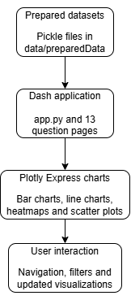

---

# Phase: Visualization and App Development

## Task: Select Visualization Techniques

### Output: Visualization Techniques

I used different visualization techniques depending on the question and the type of data.

- **Bar charts:** Used to compare sales between platforms, genres, regions and game titles. They make it easy to identify the highest and lowest values.
- **Line charts:** Used to show how sales change over time, for example sales per release year and genre popularity over time.
- **Heatmaps:** Used to compare sales shares between genres and regions, and to identify which genres perform well on different platforms.
- **Scatter plots:** Used to compare publishers' average sales and variation in sales. This helps identify publishers with more consistent results and publishers with more varied results.
- **Interactive filters:** Dropdowns, sliders and radio buttons allow users to select regions, genres, years, metrics and the number of results to display.

We chose these techniques because they make it easier to compare values, identify patterns and explore the data. All charts are created with Plotly Express and displayed in the Dash application.

## Task: Generate App Design

### Output: App Design

The application is built using Python, Dash, Plotly Express and Dash Bootstrap Components.

The application is divided into separate pages. The home page provides a simple introduction, and each of the 13 question pages contains visualizations for a specific project question.

The application uses prepared datasets stored as Pickle files in `data/preparedData`. Each question page loads the dataset it needs and creates its charts using Plotly Express.

The main file, `app.py`, sets up the application layout and navigation bar. The navigation links allow users to move between the home page and the different question pages.

The application uses Dash callbacks to update charts when users change interactive controls. This makes it possible to explore the data without manually changing the code.

</img>

## Task: Build App

### Output: App Description

The application has a home page and 13 pages, one for each project question. Users can navigate between the pages using the navigation bar at the top of the application.

Each question page contains one or more charts that present information about video game sales, platforms, genres, publishers or release years.

Users can interact with the charts using different controls. For example, they can select a region, choose specific genres, change the year range or decide how many platforms or titles to display. The charts update automatically when the selected values change.

Some charts also provide additional information when the user hovers over the data points or bars.

The application is designed to help users explore the data and find patterns that answer the project's 13 questions.
## Task: Assess App

### Output: App Assessment

The application includes 13 question pages, each designed to answer one of the project's business questions. It uses different visualization techniques and interactive controls to help users explore the data.

The application includes the following functionality:

- Comparing platform sales across regions and overall.
- Exploring sales trends by release year and platform.
- Comparing genre popularity between regions and over time.
- Analysing publisher sales performance and consistency.
- Identifying the regions with the highest recorded sales and the best-selling game titles.
- Exploring platform specialization in different genres.
- Comparing game sales between regions to find regional differences.

The application uses prepared datasets and updates charts through Dash callbacks when users change the available controls.

However, the results are limited by missing values in the original datasets. Some analyses may therefore be based on incomplete sales information.

Overall, the application provides visualizations for all 13 project questions and supports interactive exploration of the available data.